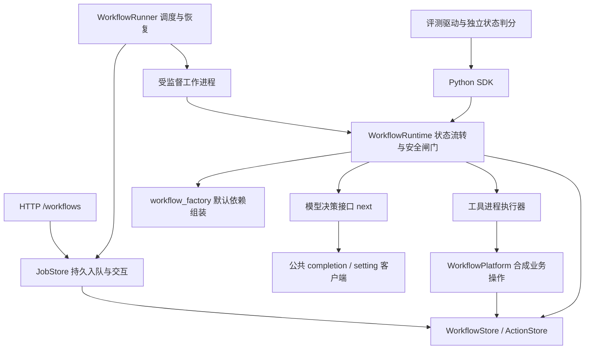

# 当前架构与阅读顺序

主链路：`/workflows` → 持久队列/调度 → 工作进程 → `WorkflowRuntime`。Python SDK 可以直接调用同一 Runtime。旧 `/agent/*` 是兼容链路，与主链路分别说明。

## 模块职责

| 模块 | 负责 | 边界 |
|---|---|---|
| `api/offline_server.py` | HTTP 输入、返回状态、入口组装 | 不决定下一步业务工具 |
| `workflow_jobs.py` / `workflow_runner.py` | 持久队列、执行槽、进程退出与恢复 | 审批+入队仍在同一事务；调度器拥有作业 SQL |
| `workflow.py` | 主循环、预算、等待、恢复、执行安全闸门 | 不直接写 SQL；通过存储/平台公共方法读写 |
| `workflow_factory.py` | 创建默认模型、具体平台、存储 | 支持注入自定义模型；没有启动进程或远程请求副作用 |
| `workflow_model.py` / `workflow_rules.py` | 远程工具决策/有限离线规则 | 共同提供 `next(messages, context, max_tokens)`；规则不是远程失败兜底 |
| `model_client.py` | 配置和 OpenAI 兼容 HTTP 传输、保留旧意图解析兼容方法 | 主链路调用公共 `completion` / `setting`；旧导入路径仅作转发 |
| `workflow_contracts.py` | 工具 schema、请求环境与输入校验 | 校验不是授权；缺 operator/env 的写操作仍由策略拒绝 |
| `workflow_policy.py` | 服务端权限与审批规则 | 运行时和实际写入阶段均校验；硬性生产禁写不交给模型 |
| `workflow_platform.py` / `tool_executor.py` | 合成平台操作、工具进程限时与取消 | 平台负责业务 SQL，执行器负责进程生命周期 |
| `workflow_store.py` / `action_store.py` | Checkpoint、引用、动作审批、回执与审计存取 | SQLite 具体实现；不宣称可无改动换数据库 |
| `workflow_context.py` / `workflow_clarification.py` / `workflow_outcome.py` | 上下文预算、补参、事实结果汇总 | 属于 Runtime 内核的协作模块，不是独立编排框架 |
| `evals/` | 固定场景、混沌/回放模型、环境状态判分 | Environment 是评测协议，不是 Runtime 的可插拔平台协议 |

## 两条事务边界

1. `JobStore.resume` 在同一 SQLite 事务里批准动作、更新任务并入队。排队满或并发冲突时整笔回滚，不能留下“已批准但未正确入队”的半状态。
2. `WorkflowPlatform._write` 在同一事务里提交合成业务数据与平台回执。平台提交后即使进程退出，Runtime 仍能按回执对账，避免重复写入。

Runtime 使用 `ActionStore.receipt` / `task_receipts` 查询事实；`cancel_action` 将取消状态与审计一起提交，已有平台回执的动作不会被覆盖成取消。回执查询校验操作人、会话、环境，任务查询还绑定完整任务 ID 前缀。

没有把所有数据库操作都搬进单个通用仓库：作业 SQL 由队列/调度拥有，业务 SQL 由平台拥有，动作和状态 SQL 由相应存储拥有。关键是编排逻辑不再解释表结构，事务所有者仍然明确。

## 刻意保留的关联

- 审批、幂等、回执和执行内核保持内聚，不能通过更换模型绕过。
- Runtime、JobStore 和 Store 共享持久状态结构；本轮没有加入通用状态机 DSL。
- 当前默认平台与存储仍固定为 SQLite mock；factory 集中组装不等于已经实现通用平台/数据库替换。
- 平台仍复用部分旧 Mock 基类与纯 Python 权限辅助代码；本轮没有搬迁整个历史目录，也不代表彻底消除了所有历史模块依赖。
- `model_call.py` 是 Runtime 的预算、重试和 Trace 协作模块，仍使用 Runtime 状态；模型本身通过 `next` 替换。

## 阅读代码的顺序

先读 `workflow_contracts.py` 的支持范围，再读 `workflow.py` 的 start/resume/drive；随后看 `workflow_factory.py`、模型适配器和平台写入事务。需要理解 HTTP 并发与恢复时再读 JobStore/Runner，最后看评测与测试。

兼容路径在 [legacy-runtime.md](legacy-runtime.md)，使用示例在 [workflow-guide.md](workflow-guide.md)。
